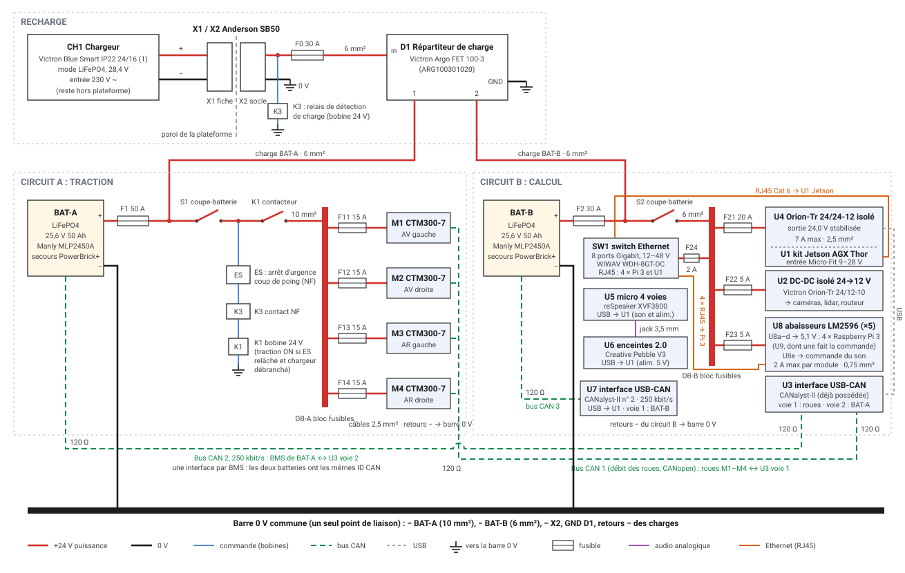

# Alimentation et câblage

Deux batteries LiFePO4 25,6 V / 50 Ah Manly MLP2450A (PowerBrick+ en secours si le délai de livraison est trop long), deux circuits séparés, une seule prise de recharge.

- **Circuit A, traction** : BAT-A alimente les 4 roues. L'arrêt d'urgence mécanique (contacteur K1) coupe ce circuit, et ce circuit seulement.
- **Circuit B, calcul** : BAT-B alimente le Jetson à travers un convertisseur isolé 24 → 24 V (U4), ses périphériques, les Raspberry Pi et la commande du son.
- **Recharge** : le chargeur se branche sur le socle X2. Le répartiteur D1 recharge les deux batteries en même temps. Tant que le chargeur est branché, le relais K3 bloque la traction.
- **Audio** : un micro à 4 voies (reSpeaker XVF3800) et des enceintes USB (Creative Pebble V3), branchés sur le Jetson, pour dialoguer avec la sculpture. Le son passe par la sortie jack du micro pour que l'annulation d'écho fonctionne.
- **Commande** : quatre Raspberry Pi 3 (déjà possédées), alimentées chacune en 5,1 V par un abaisseur LM2596 branché sur le circuit B ; l'une d'elles commande la sculpture. Un autre abaisseur alimente la commande du son.
- **Caméras** : 4 caméras grand angle 120° (Camera Module 3 Wide) filment en même temps, chacune sur sa Raspberry Pi 3. Les Raspberry Pi rejoignent le Jetson par un switch Ethernet industriel (SW1) alimenté en 24 V.
- **CAN** : la voie 1 du CANalyst-II U3 pilote les roues. Les deux batteries Manly répondent aux mêmes ID CAN : chacune a donc son bus, à 250 kbit/s. BAT-A est lue par la voie 2 de U3, BAT-B par un second CANalyst-II (U7).

Document complet : [page HTML](Alimentation_cablage.html) (à télécharger puis ouvrir dans un navigateur) ou [PDF](Alimentation_cablage.pdf).

Suivi des commandes et des livraisons : [page de suivi](https://claude.ai/artifact/BQt3Wj4pTv8n3fSTWZw6n2) (accès sur partage).

## Batteries Manly (retenues) : documents du fabricant

- [Fiche technique MLP2450A, 25,6 V 50 Ah](batteries_manly/MANLY_25.6V_50Ah_Datasheet.pdf)
- [Protocole CAN du BMS (JBD)](batteries_manly/CAN_JBD.pdf) : 250 kbit/s, ID standard de 0x100 à 0x112, interrogation par trame « remote » (RTR), CRC-16 Modbus. Les deux batteries répondent aux mêmes ID : voir la section « Devis Manly » du [PDF](Alimentation_cablage.pdf).

## Schéma de câblage

## Nomenclature

**Déjà possédé**

| Repère | Désignation | Référence | Qté | Caractéristiques, remarques | Prix indicatif | Lien |
|---|---|---|---|---|---|---|
| M1–M4 | Roues motorisées | RoboCT CTM300-7 (24 V) | 4 | Déjà en place sur la plateforme. | — | [RoboCT](https://www.roboct-global.com/mobile-robot-components/mecanum-wheel/mecanum-omni-wheel.html) |
| U1 | Calculateur | NVIDIA Jetson AGX Thor, kit de développement (T5000) | 1 | Alimenté par son entrée Micro-Fit 9–28 V continu (8 A max), à travers U4. Vérifier le brochage du connecteur Micro-Fit dans le guide NVIDIA. | — | [Amazon](https://www.amazon.fr/dp/B0FTM2LXSF) |
| U9 | Raspberry Pi des caméras et de la commande | Raspberry Pi 3 | 4 | Une carte par caméra U10, pour que les 4 caméras filment en même temps ; l'une d'elles commande aussi la sculpture. Toutes identiques, pour uniformiser le matériel. La caméra Camera Module 3 fonctionne sur Pi 3 (Raspberry Pi OS récent, pile libcamera) ; la Pi 3 encode la vidéo en H.264 jusqu'en 1080p30. Chacune alimentée en 5,1 V par son abaisseur U8 (connecteur micro-USB). Alimentation conseillée : 5,1 V et 2,5 A ; la carte et la caméra consomment en pratique moins de 1 A. | — | — |

**Fournisseur 1 : Conrad.fr (énergie Victron, commande, câblage, caméras)**

| Repère | Désignation | Référence | Qté | Caractéristiques, remarques | Prix indicatif | Lien |
|---|---|---|---|---|---|---|
| CH1 | Chargeur 24 V | Victron Blue Smart IP22 24/16 (1), BPC241642002 (Conrad 1924441) | 1 | Programme LiFePO4 (28,4 V), Bluetooth. Convient aux batteries Manly comme aux PowerBrick+. Reste hors de la plateforme. | 195,83 € HT | [lien](https://www.conrad.fr/fr/p/victron-energy-chargeur-pour-batteries-au-plomb-blue-smart-2416-24-v-courant-de-charge-max-16-a-1924441.html) |
| D1 | Répartiteur de charge | Victron Argo FET 100-3, ARG100301020R (Conrad 1846191) | 1 | 2 sorties utilisées. Relier sa borne GND au 0 V. | ≈ 115 € (est.) | [lien](https://www.conrad.fr/fr/p/victron-energy-argo-fet-100-3-arg100301020r-separateur-de-batterie-1846191.html) |
| U4 | Convertisseur isolé 24 → 24 V | Victron Orion-Tr 24/24-12A, 280 W, isolé (Conrad 1666865) | 1 | Alimente le Jetson en 24 V stabilisé : une batterie LiFePO4 en charge monte à 28,4–29,2 V, au-delà des 28 V admis par le kit Thor. 280 W suffisent (Jetson ≤ 8 A). | ≈ 140–190 € (est.) | [lien](https://www.conrad.fr/p/victron-energy-orion-tr-2424-12a-280w-isolated-dc-dc-converter-convertisseur-cccc-24-vdc-24-vdc12-a-280-w-1666865) |
| U2 | Convertisseur isolé 24 → 12 V | Victron Orion-Tr 24/12-10, 120 W (Conrad 1666873) | 1 | Pour les équipements en 12 V. Facultatif. | ≈ 70 € (est.) | [lien](https://www.conrad.fr/fr/p/victron-energy-orion-tr-24-12-10-convertisseur-cc-cc-24-v-dc-12-5-v-dc-12-a-120-w-1666873.html) |
| S1, S2 | Coupe-batteries | Victron 275 A, VBS127010010 | 2 | Placés après le point de charge : les batteries se rechargent même interrupteurs ouverts. | 47,99 € pièce | [rayon Victron](https://www.conrad.fr/fr/o/accessoires-de-chargeur-0501180.html) |
| F0, F1, F2 | Porte-fusibles MIDI | Victron CIP000050001 | 3 | Au plus près des bornes + (F1, F2) et derrière X2 (F0). Fusibles MIDI : 50 A pour F1, 30 A pour F0 et F2. | 16,99 € pièce + fusibles | [rayon Victron](https://www.conrad.fr/fr/o/accessoires-de-chargeur-0501180.html) |
| DB-A, DB-B | Distribution à fusibles | Barre Victron VBB125040010 (Conrad 2497142) et porte-fusibles pour fusibles plats standard, 32 V | 1 + 8 | La barre sert de répartiteur pour la traction ; chaque départ a son porte-fusible plat. DB-A : 4 × 15 A. DB-B : 20 A (U4), 5 A (U2), 5 A (U8, abaisseurs), 2 A (SW1, switch). | ≈ 60 € (est.) | [barre](https://www.conrad.fr/fr/p/victron-energy-bus-bar-vbb125040010-plaque-de-montage-2497142.html) · [porte-fusibles](https://www.conrad.fr/fr/f/porte-fusible-plat-1838146.html) |
| X1, X2 | Connecteur de charge | Connecteur de batterie à courant fort 50 A (Conrad 1229364) | 2 | X1 au bout du câble du chargeur, X2 fixé sur la paroi. | ≈ 10 € pièce (est.) | [lien](https://www.conrad.fr/fr/p/connecteur-de-batterie-a-courant-fort-50-a-1229364-1-pc-s-1229364.html) |
| ES | Arrêt d'urgence | Schneider Harmony XB5AS8444, coup de poing Ø40, 2 NF (Conrad 1983553) | 1 | Un contact NF coupe la bobine de K1 ; le second reste libre (par exemple pour signaler l'arrêt au Jetson). | ≈ 40 € (est.) | [lien](https://www.conrad.fr/p/arret-durgence-schneider-electric-xb5as8444-xb5as8444-1-pcs-1983553) |
| K3 | Relais de détection de charge | Finder 38.51.7.024.0050, bobine 24 V, 1 inverseur, rail DIN (Conrad 502788) | 1 | Utiliser le contact NF de l'inverseur. | 17,49 € HT | [lien](https://www.conrad.fr/fr/p/relais-de-base-finder-385170240050-385170240050-1-tension-nominale-24-vdc-courant-de-commutation-max-6-a-1-inverseur-rt-1-pcs-502788.html) |
| — | Câblage | Câble souple rouge et noir, câble CAN blindé, cosses | — | 10 mm² entre BAT-A et la distribution ; 6 mm² pour la charge et le circuit B ; 2,5 mm² vers les roues et U4. Câble CAN : paire torsadée blindée, terminaisons 120 Ω aux deux bouts de chaque bus (trois bus : roues, BMS de BAT-A, BMS de BAT-B). | ≈ 100–145 € (est.) | [Conrad](https://www.conrad.fr/) |
| U10 | Caméras grand angle | Raspberry Pi Camera Module 3 Wide, SC1224 (Conrad 2751821) | 4 | Capteur Sony IMX708, 11,9 Mpx, champ de 120° (102° × 67°), mise au point automatique, HDR. Vidéo 1080p50. Nappe de 200 mm fournie. Les 4 caméras doivent filmer en même temps : chacune a sa Raspberry Pi 3 (U9), qui n'a qu'un port caméra CSI. Caméra compatible avec la Pi 3 : même port CSI à 15 broches, nappe fournie. Version infrarouge pour la faible lumière : SC1226. | 36,66 € HT pièce 146,64 € HT les 4 | [lien](https://www.conrad.fr/fr/p/raspberry-pi-sc1224-camera-module-3-wide-module-de-camera-couleur-cmos-convient-pour-kits-de-developpement-raspb-2751821.html) |

**Fournisseur 4 : Amazon.fr (audio, interface CAN, abaisseurs, réseau)**

| Repère | Désignation | Référence | Qté | Caractéristiques, remarques | Prix indicatif | Lien |
|---|---|---|---|---|---|---|
| U5 | Micro à 4 voies | Seeed Studio reSpeaker XVF3800, réseau de 4 micros USB, carte nue | 1 | 4 micros MEMS sur 360°, captation jusqu'à 5 m. Traitement intégré : annulation d'écho, formation de faisceau, direction de la voix, détection de parole, réduction de bruit. Vu comme un micro USB standard, sans pilote, compatible Jetson. Branché sur un port USB du Jetson, qui l'alimente. Carte nue : prévoir un boîtier ou une fixation. | 134,99 € TTC | [Amazon](https://www.amazon.fr/dp/B0FKGFXQQ5) |
| U6 | Enceintes 2.0 | Creative Pebble V3, USB-C, Bluetooth 5.0 | 1 | 8 W RMS (16 W crête), alimentées en 5 V par l'USB du Jetson. Entrée audio : de préférence le jack 3,5 mm relié à la sortie son de U5, pour que l'annulation d'écho du micro reçoive ce que dit la sculpture (voir « Points à vérifier »). Câble jack 3,5 mm mâle-mâle à prévoir s'il n'est pas dans la boîte. | 29,99 € TTC | [Amazon](https://www.amazon.fr/dp/B08F5BQZL8) |
| — | Câbles USB | Anker 331, USB-A vers USB-C, 1,8 m, lot de 2 | 2 lots | Soit 4 câbles : un pour U5, un pour U6, deux en réserve. | 8,11 € le lot 16,22 € les 2 | [Amazon](https://www.amazon.fr/dp/B07DC5PPFV) |
| U3 | Interface USB-CAN | CANalyst-II (ZLGCANpro) | 1 | Deux voies CAN, isolées d'après le vendeur. Voie 1 : bus des roues. Voie 2 : BMS de BAT-A, à 250 kbit/s. Sous Linux, pilote non officiel `python-can[canalystii]` (pyusb), qui interroge le boîtier en boucle : la latence et l'envoi de trames « remote » (RTR) sont à tester sur le Jetson. | 97,00 € TTC | [Amazon](https://www.amazon.fr/dp/B07WC1XX1S) |
| U7 | Seconde interface USB-CAN | CANalyst-II (ZLGCANpro), identique à U3 | 1 | Les deux batteries Manly répondent aux mêmes ID CAN : chacune a donc son propre bus. Voie 1 : BMS de BAT-B, à 250 kbit/s, terminaisons 120 Ω aux deux bouts. Voie 2 libre. Même pilote que U3 sous Linux. | 97,00 € TTC | [Amazon](https://www.amazon.fr/dp/B07WC1XX1S) |
| U8 | Abaisseurs de tension | CAIHINIER QY-11LM2596S, régulateur DC-DC LM2596, lot de 4 | 5 lots | Entrée 4–40 V, sortie réglable de 1,25 à 37 V par potentiomètre, 2 A max, bornes à vis, non isolé. Alimentés par F23 (5 A) depuis DB-B. U8a à U8d : 5,1 V, un module par Raspberry Pi 3 (U9). U8e : commande du son, tension à préciser. 5 lots, soit 20 modules : 5 sur la plateforme, les autres en réserve. Régler la tension au multimètre avant de brancher la charge. | 12,99 € le lot 64,95 € les 5 | [Amazon](https://www.amazon.fr/dp/B0HFHT9BVJ) |
| SW1 | Switch Ethernet | WIWAV WDH-8GT-DC, industriel, 8 ports Gigabit, non administrable | 1 | Relie les 4 Raspberry Pi 3 au Jetson U1 pour transmettre la vidéo des caméras. Alimenté directement en 24 V par F24 (2 A) depuis DB-B : entrée 12–48 V sur bornier, moins de 4 W, protection contre l'inversion de polarité. Sans ventilateur, rail DIN, −30 à 75 °C. Cordons : voir « Cordons réseau ». | 79,99 € TTC | [Amazon](https://www.amazon.fr/dp/B073Z73TGX) |
| — | Cartes microSD | SanDisk Extreme 64 Go microSDXC, A2, U3, V30 | 4 | Une carte par Raspberry Pi 3 : système, logiciel de capture, et place pour enregistrer photos et vidéos (environ 1 Go pour 15 min de vidéo 1080p en H.264 à 10 Mbit/s). Marque reconnue, plus fiable que les cartes sans marque sur un robot qui vibre. | 23,99 € pièce 95,96 € les 4 | [Amazon](https://www.amazon.fr/dp/B09X7CXWQQ) |
| — | Cordons réseau | deleyCON, câble patch Cat 6 S/FTP blindé, 1 m, lot de 5 | 1 lot | Relient les 4 Raspberry Pi 3 et le Jetson U1 au switch SW1. Blindés, à cause des moteurs voisins. Prendre plus long si des Raspberry Pi sont loin du switch. | 14,65 € TTC | [Amazon](https://www.amazon.fr/dp/B01MRSXXCZ) |

**Fournisseur 2 : batteries Manly (retenues), PowerBrick+ en secours**

| Repère | Désignation | Référence | Qté | Caractéristiques, remarques | Prix indicatif | Lien |
|---|---|---|---|---|---|---|
| BAT-A, BAT-B | Batterie LiFePO4 25,6 V 50 Ah (Manly), **retenue** | Manly MLP2450A avec CAN (protocole BMS JBD) | 2 | **Le niveau de charge se lit sur le bus CAN**, donc par le Jetson (une interface USB-CAN par batterie : U3 et U7). BMS 50 A en continu, 60 A en pointe (< 1 s), IP67, 6 000 cycles à 80 %, garantie 5 ans, bornes M6. 330 × 172 × 237 mm, 10,3 kg. Charge à 29,0 V. Devis reçu : livraison DDP par avion, délai de 15 à 20 jours ouvrés plus 12 à 15 jours de transport. | 298 USD pièce 994 USD les 2, port DDP compris | [lien](https://www.manlybatteries.com/24v-lifepo4-battery/lithium-24v-50ah-battery.html) · [gamme robots](https://www.manlybatteries.com/24v-lifepo4-battery/battery-for-autonomous-mobile-robots.html) |
| Secours | Batterie LiFePO4 25,6 V 50 Ah (Wattuneed) | PowerTech Systems PowerBrick+ PB+24/50 (marque française) | 2 | **À commander seulement si le délai de Manly est trop long.** Disponible en France. BMS intégré, 50 A en continu, 1,28 kWh, IP65, plus de 3 000 cycles. 260 × 168 × 212 mm, 11,8 kg. Pas d'état de charge sur le bus CAN : U7 devient inutile. | 685 € TTC pièce | [lien](https://www.wattuneed.com/fr/batteries-lithium/15121-batterie-lithium-powerbrick-pb2450-50-ah-256-v-lifepo4-128-kwh-ip65-0768563816338.html) |

**Fournisseur 3 : RS Components France**

| Repère | Désignation | Référence | Qté | Caractéristiques, remarques | Prix indicatif | Lien |
|---|---|---|---|---|---|---|
| K1 | Contacteur de puissance | Durakool DEVR10-5061-S8-1024-R1, 100 A, bobine 24 V continu (RS 105-8538) | 1 | Seul article commandé chez RS : ni Conrad ni Amazon n'ont de contacteur équivalent. Conrad ne propose que des relais à souder sur circuit imprimé ; Amazon, des copies d'Albright SW80 de vendeurs inconnus, à éviter pour la coupure d'arrêt d'urgence. Délai de livraison à vérifier. | 161,08 € HT | [lien](https://fr.rs-online.com/web/p/contacteurs/1058538) |

Les références sont des exemples à confirmer auprès des fournisseurs avant la commande. Les prix ont été relevés en novembre 2026 et n'incluent pas toujours la livraison.
